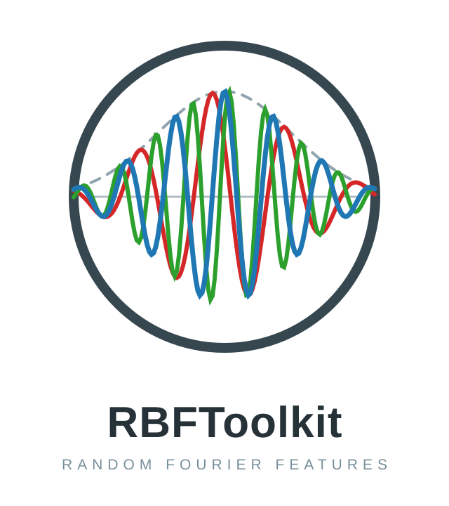

# RBFToolkit — Kernel-Methoden auf der GPU

Support Vector Machines gehören zu den am gründlichsten verstandenen Klassifikationsverfahren des maschinellen Lernens: konvexe Optimierung, maximale Marge, generalisierungstheoretische Garantien, die keine andere Methode in dieser Schärfe bietet. Ihr Handicap ist anderer Natur. Der Kernel-Trick erlaubt nichtlineare Grenzen, ohne jemals einen Feature-Raum zu betreten, aber er bezahlt diese Eleganz mit einer Kernel-Matrix, die quadratisch in der Punktzahl wächst, und mit einem Training über sequenzielle Zerlegungslöser, die von paarweiser Feinarbeit leben statt von Matmul-Durchsatz. Genau deshalb bleiben SVMs auf CPU-Skalierung festgelegt, während die verfügbare Rechenhardware längst anders rechnet. Dieses Projekt fragt: Lässt sich die Kernidee — maximale Marge unter einem Gauß-Kernel — auf die GPU eines Apple-Silicon-Macs übersetzen, ohne die mathematische Substanz aufzugeben?

Die Antwort liefert ein Satz von 2007. Rahimi und Recht zeigen in "Random Features for Large-Scale Kernel Machines", dass sich der Gauß-Kernel als Erwartung über Kosinus-Wellen mit normalverteilter Frequenz schreiben lässt — ein Ergebnis, das auf der Bochner-Theorie beruht. Statt den Kernel implizit zu nutzen, zieht man m Zufallsrichtungen ω und bildet jeden Punkt auf z(x) = sqrt(2/m) · cos(ω·x + b) ab. Das Skalarprodukt zweier Feature-Vektoren ist dann ein Monte-Carlo-Schätzer des Kernels, dessen Fehler mit 1/sqrt(m) fällt; die nichtlineare SVM wird zu einem linearen Problem in expliziten Koordinaten. Die Struktur dieser Abbildung ist bemerkenswert konstant: Alle Feature-Vektoren liegen auf der Einheitssphäre, und gamma, der einzige Kernel-Parameter, bestimmt die Wellenlängen — kleine Werte erzeugen lange, glatte Wellen, große Werte nervöses Rauschen. Die U-Kurve der Cross-Validierung über gamma ist deshalb keine Blackbox, sondern in den Wellen direkt sichtbar.

Die Umsetzung nutzt MLX, Apples Array-Framework für Apple Silicon, in Swift. Die Feature-Abbildung wird zu einer Matmul mit Kosinus — genau die Operation, für die Unified Memory und GPU gebaut sind —, und das Training ist ein lineares SVM-Modell per Mini-Batch-SGD mit Hinge-Loss und L2-Regularisierung: Aus einem sequenziellen quadratischen Programm ist ein Durchsatz-Problem geworden. Ein Designprinzip zieht sich durch die gesamte Pipeline: Determinismus. Ein eigener SplitMix64-Generator erzeugt die Folds und die Batch-Reihenfolge (mit Epochen-indexiertem Seed), sodass zwei Läufe mit gleichen Seeds bit-identische Modelle liefern — ein Anspruch, den die Pipeline bis in die exportierten Visualisierungen hält. Das gamma-Tuning arbeitet mit 5-fach-Kreuzvalidierung über vier Größenordnungen und einer Plateau-Logik, die das breiteste stabile Intervall sucht und dessen geometrische Mitte wählt, statt sich auf den ersten besten Maximumswert zu verlassen.

Vertrauen entsteht durch Nachrechnen, nicht durch Behaupten. Eine CPU-Referenz prüft die MLX-Feature-Map Zeile für Zeile gegen eine unabhängige Berechnung (Abweichung unter 1e-5); ein Test vergleicht für hunderte Punktpaare das Feature-Skalarprodukt mit dem exakten Gauß-Kernel und hält die Monte-Carlo-Schranken ein; weitere Tests sichern die Einheitssphären-Eigenschaft und die Reproduzierbarkeit. Nach außen trägt das Projekt dieselbe Idee: Der VTK-Export führt Punkte, Labels und Entscheidungswerte nach ParaView, wo die Marge (|f| = 1) als Schale sichtbar wird — das Random-Feature-Äquivalent der Support-Vektoren —, und der Vergleich zweier Regularisierungsstärken zeigt, dass Regularisierung hier eine Frage der Skala ist, nicht der Grenzlage. Drei Visualisierungen machen die Theorie schließlich konkret: die Wellen für zwei gamma-Werte, das Wellenfeld einer Komponente als Gitter, und die Punktwolke aus exaktem Kernel und Näherung auf der Diagonalen.

Aus einem Experimentierskript ist in wenigen Tagen ein Swift Package geworden, das dem Vorbild mlx folgt: eine Bibliothek mit klarer öffentlicher API, ein ausführbares Demo-Target und eine Test-Suite, die bei jedem Lauf die Korrektheitsansprüche der Methode prüft. Die eigentliche Erkenntnis liegt eine Ebene tiefer: Die Kombination klassischer Kernel-Methoden mit modernen GPU-Arrays ist kein museales Unterfangen. Random Fourier Features kehren die Schwäche der SVM — sequenzielle Quadratic-Programming-Löser, die GPUs brachliegen lassen — in ihre GPU-Stärke um: lineares SGD auf expliziten Features, auf Datenpunktzahlen, die für klassische Kernel-SVMs jenseits des Machbaren liegen. Offen bleibt die dynamische Dimension — Trainingsepochen als Zeitsequenz, die Entscheidungsoberfläche als Fläche, eigene Metal-Kernel für die Feature-Abbildung —, und damit die Richtung: dass dort, wo die MLX-Community heute überwiegend Sprachmodelle trainiert, auch die klassische Theorie des maschinellen Lernens einen natürlichen Platz hat.
